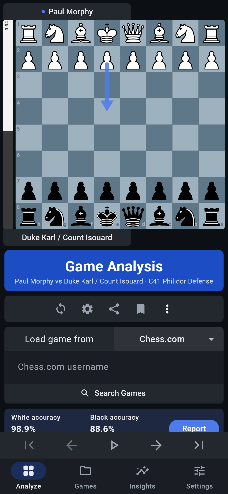
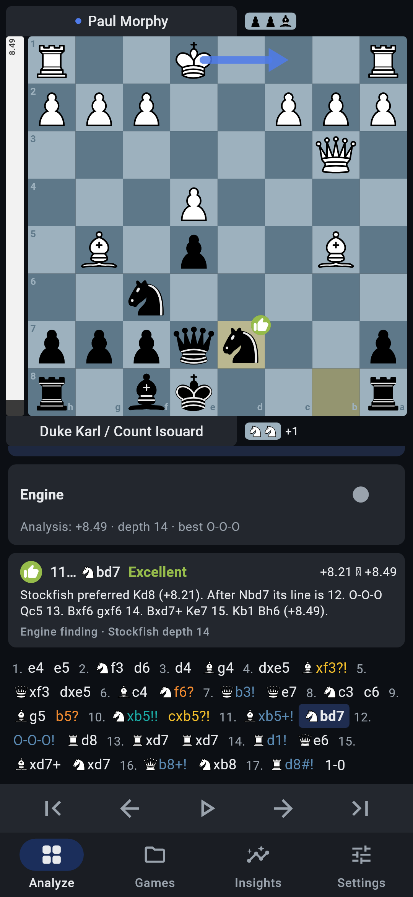
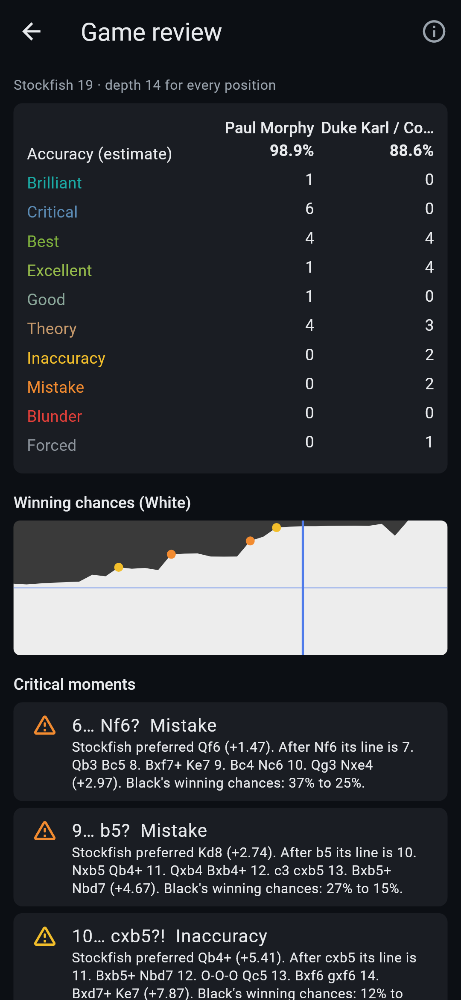
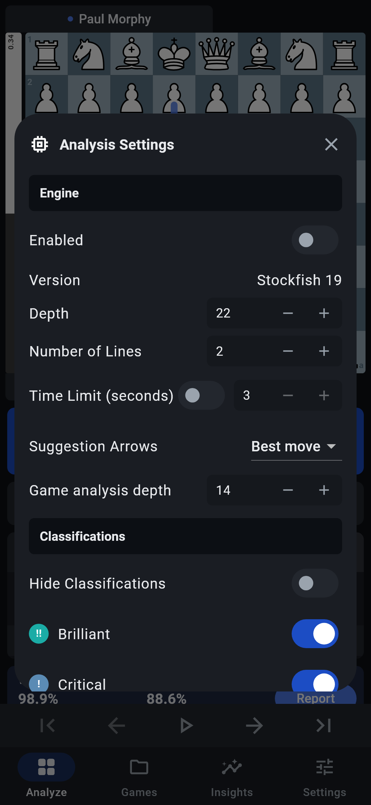

# Ply

**Every move teaches.**

Ply is a personal chess analysis app for Android. Load your games (PGN, FEN,
or straight from Chess.com / Lichess), let a real Stockfish 19 engine running
on your phone review every move, and see which kinds of mistakes keep coming
back. No account, no subscription; the board, engine and saved games work
offline.

<p>
  
  
  
  
</p>

<sub>Screenshots are rendered from the app's real widget tree with a real
Stockfish 19 review (`test/render_screens_test.dart`), not captured on a phone.
The game is Morphy's 1858 "Opera Game".</sub>

## Features

**Board**
- Tap-to-move and drag-and-drop, legal-move dots, last-move and check
  highlights, promotion picker, flip, coordinates
- Cburnett pieces (SVG, sharp at any size); slate-blue board
- Move list in figurine or plain SAN ("Simple Move Notation"), kept in sync
  with the board; first / previous / play-through / next / last controls;
  playing a different move mid-game replaces the rest, with Undo
- Player tabs with captured material

**Load and share**
- "Load game from" PGN (paste or open a file), FEN, **Chess.com** or
  **Lichess**: enter a username, tap *Search Games*, pick a recent game.
  Online loading uses the sites' public, no-login APIs and is optional.
- Share Game: FEN and PGN with copy buttons, or save a `.pgn` file. Reviewed
  games export with classifications as NAGs and engine comments.

**Engine (Stockfish 19, on the device)**
- Live analysis with depth or time limit, up to five lines (MultiPV),
  suggestion arrows (off / best move / all lines)
- Tap a move in an engine line to step through it on the board, then
  optionally play it into the game
- Evaluation bar and labels always from White's point of view
  (`+` favours White, `−` favours Black); mates shown as `#3` / `#-3`
- Partial searches are labelled as partial (stopped / depth n of m)

**Game analysis and blunder detection** (the *Analyse* button)
- Every position is searched at the *same* fixed depth with two lines, so
  before/after evaluations are comparable
- Classes: Brilliant, Critical, Best, Excellent, Good, Theory, Inaccuracy,
  Mistake, Blunder, Forced (see below); Brilliant, Critical and Theory can be
  switched off, and all classifications can be hidden
- Tags for missed mates, allowed mates, missed wins and missed tactics
- Explanations are assembled only from Stockfish's output (its preferred
  move and the line after your move) and labelled as engine findings
- Report: accuracy estimates with their limitations, counts per side,
  winning-chances graph, critical moments, missed opportunities and every
  move; tap anything to jump there
- Stop and resume at any time; results are saved with the game

**Games and insights**
- Local library with search and filters (result, colour, time control),
  editable details, and which side you played
- Insights from your own moves in reviewed games: accuracy and its trend,
  accuracy by phase, errors per game, results, openings with repeated early
  errors, missed tactics to retry, positions you pinned
- Weakness categories (tactics, defence, converting advantages, opening,
  quiet middlegames, endgame) are only called **recurring** with enough
  evidence: at least 5 reviewed games, at least 30 relevant moves, errors in
  at least 3 different games, and a rate at least 25% above your own
  average. Otherwise Ply says "Not enough data" or "In line with your average".

## How the analysis works

Stockfish reports a score for the side to move. Ply converts every score to
White's perspective, then to White's winning chance with the Lichess curve

    win% = 50 + 50 × (2 / (1 + e^(−0.00368208 × cp)) − 1)      (cp clamped to ±1000; mate = 0% or 100%)

A move's **loss** is the drop in the *mover's* win% from the position before
to the position after the move.

| Class | Rule |
|---|---|
| Theory | Every position from the start up to this move is in the opening list |
| Brilliant | Stockfish's first choice that gives up material (a non-pawn piece the opponent can take for less than it is worth), while not losing (win% after ≥ 45) and not already totally winning (≤ 95) |
| Critical | Stockfish's first choice, and its second choice is at least 10 win% worse |
| Best | Stockfish's first choice |
| Excellent | loss < 2 |
| Good | loss 2–5 |
| Inaccuracy | loss ≥ 5 |
| Mistake | loss ≥ 10 |
| Blunder | loss ≥ 15 |
| Forced | the only legal move |

Inaccuracy/mistake/blunder thresholds are Lichess's defaults and can be
changed in Settings. Checkmate, stalemate and insufficient material are
decided by the rules, not the engine. Move accuracy uses the Lichess formula
`103.1668 × e^(−0.04354 × loss) − 3.1669 + 1`; game accuracy is the plain
average over your moves, leaving out theory and forced moves.

**Limitations of these numbers:** they depend on the analysis depth (default
14 on a phone, far below a server analysis), every move counts equally,
multi-threaded searches vary slightly between runs, and the values are not
comparable with Chess.com or Lichess accuracy. Brilliant uses a simple
static material check, not a full exchange evaluation. "Missed tactic" means
the engine's move was a capture, check or promotion where you made a mistake
or blunder; it is a heuristic. Game phase is estimated from move number and
remaining material.

## Technology

- **Flutter 3.47 / Dart 3.13**: one codebase with a reliable Android
  toolchain and fast custom painting for the board. The analysis, storage and
  UI logic are plain Dart and unit-test well on a desktop.
- **[dartchess](https://pub.dev/packages/dartchess)** (the Lichess team's Dart
  chess library) for legal moves, SAN, FEN and PGN, instead of writing chess
  rules from scratch.
- **Stockfish 19**: the official Android arm64 release binary, packaged as
  `libstockfish.so` so Android extracts it to the app's native library
  directory, the only place an app may execute files from (Android 10+). The
  app runs it as a child process and speaks UCI over stdin/stdout. No NDK
  build; the binary is byte-identical to the official release.
- **Opening names** from the Lichess
  [chess-openings](https://github.com/lichess-org/chess-openings) list (CC0),
  indexed in a background isolate at startup.
- Storage is one JSON file in the app's private storage, written atomically
  (temp file + rename). An unreadable file is set aside, never overwritten.

```
lib/
  chess/       game model on dartchess: moves, FEN, PGN
  engine/      UCI client (uci.dart) and the Stockfish process service
  analysis/    evaluation, classification, opening book, review runner, insights
  online/      Chess.com / Lichess public game download
  storage/     saved games, positions to revisit, settings
  ui/          board, screens, controller
```

## Build

Requirements: Flutter 3.47+, JDK 17, Android SDK (platform 36), and internet
access for the first build (Gradle downloads the Stockfish release, about
80 MB, and verifies its SHA-256).

```bash
flutter pub get
flutter build apk --release --target-platform android-arm64
```

Output: `build/app/outputs/flutter-apk/app-release.apk` (about 85 MB; the Stockfish binary with its embedded neural network is 100 MB uncompressed).

The Gradle task `fetchStockfish` (`android/app/build.gradle.kts`) downloads
`stockfish-android-arm64-universal.tar.gz` from the `sf_19` release, checks
the archive and binary checksums, and stages the binary under `build/`.
Nothing large is committed to git. `android/gradle.properties` disables
Kotlin incremental compilation, which breaks on Windows when the project and
the pub cache are on different drives.

The release build is signed with your local Android debug key, which is fine
for installing on your own phone. Add a real signing config before
publishing it anywhere.

### Install on a phone

1. Copy `app-release.apk` to the phone (or run `adb install app-release.apk`).
2. Allow "Install unknown apps" for your file manager when Android asks.
3. Open Ply → Settings → **Check engine** to confirm Stockfish starts and
   searches on your device.

Requires Android 10 (API 29) or newer on a 64-bit ARM (arm64-v8a) device,
which covers nearly all phones from recent years.

## Tests

```bash
flutter analyze
flutter test
```

Unit and widget tests cover legal moves, castling, en passant, promotion,
checkmate and stalemate, FEN/PGN parsing and errors, UCI parsing and engine
lifecycle (handshake, stop, superseded searches, crash, timeout), evaluation
perspective, every classification rule including mate tags, the opening
book, the review runner (cancel/resume), storage round trips and corrupt-file
handling, insights evidence rules, multi-game PGN splitting, and tapping
moves on the board.

Optional tests, skipped unless enabled:

```bash
# Against a real Stockfish binary for your desktop OS
STOCKFISH_PATH=/path/to/stockfish flutter test test/stockfish_integration_test.dart
# Against the live Chess.com and Lichess APIs
PLY_ONLINE=1 flutter test test/online_live_test.dart
# Regenerate the screenshots
PLY_RENDER_DIR=docs/screenshots STOCKFISH_PATH=/path/to/stockfish flutter test test/render_screens_test.dart
```

## Known limitations

- **Not yet tested on a phone or emulator.** The development PC has no
  hypervisor enabled, so the Android emulator cannot run. Engine behaviour is
  verified on desktop with the same Stockfish 19 version, and the APK's
  packaging (binary checksum, `extractNativeLibs`) is verified, but the first
  on-device run is still to be done. Use Settings → Check engine.
- Only arm64-v8a is supported. 32-bit ARM and x86 devices are not.
- Ply keeps the mainline of a game. PGN side variations and comments are
  dropped on import (review annotations are added on export).
- Standard chess only (no Chess960 or other variants).
- Chess.com search covers up to 40 standard games from the last six months;
  Lichess the last 40.
- Threefold repetition and the 50-move rule are not announced on the board,
  although the engine sees the move history and scores repetitions as draws.
- A long game at a high depth takes minutes on a phone and stops if Android
  kills the app.

## Licenses

- Ply's own code: MIT (`LICENSE`).
- Stockfish 19: GPL-3.0. Cburnett pieces: GPL-2.0-or-later. dartchess:
  GPL-3.0. Because these are bundled, the distributed APK as a whole is under
  the GPL-3.0; this repository plus the referenced upstream sources is its
  complete source.
- Opening names: CC0 (Lichess chess-openings).

Ply is not affiliated with Chess.com, Lichess or the Stockfish project.
See [THIRD_PARTY_NOTICES.md](THIRD_PARTY_NOTICES.md) for versions, sources,
checksums and attribution.
