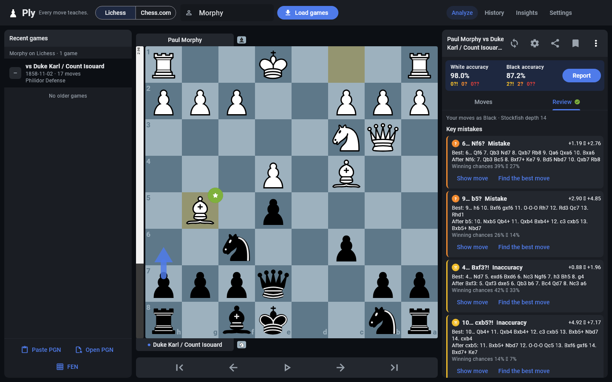

# Ply

**Every move teaches.**

Ply is a post-game chess analysis app for Windows (and Android). Pick Lichess
or Chess.com, type a username, open one of the recent games, and let
Stockfish 19, running on your own PC, find the mistakes, the better moves and
what to learn from them. No account, no subscription, no cloud.



<sub>Screenshots are rendered from Ply's real widget tree with a real
Stockfish 19 analysis (`test/render_screens_test.dart`). The game is Morphy's
1858 "Opera Game".</sub>

## Install on Windows

1. Download `Ply-Setup-1.1.0.exe` (or the portable
   `Ply-1.1.0-windows-x64-portable.zip`).
2. Run the installer. It installs for your user only, needs no administrator
   rights, adds Ply to the Start menu and optionally to the desktop.
   *Portable zip:* unzip anywhere and run `Ply\Ply.exe`.
3. Windows SmartScreen may warn that the app is unrecognised, because it is
   not code-signed. Choose **More info → Run anyway**.

Requirements: 64-bit Windows 10 or 11. Nothing else to install: Stockfish is
included.

**Update:** run the newer `Ply-Setup-x.y.z.exe`; it replaces the old version
and keeps your settings and history.
**Uninstall:** Windows Settings → Apps → Installed apps → Ply → Uninstall.
Your settings and any saved history stay in `%APPDATA%\Simpledog1\Ply`; delete
them first in Ply (Settings → Profiles & privacy) or remove that folder.

## Using Ply

1. **Choose the site** (Lichess or Chess.com) in the top bar and **type a
   username**, then press Enter or **Load games**. Recent public games
   appear on the left, newest first; **Load more** fetches older ones.
   Usernames you used before are suggested as you type.
2. **Click a game.** The board turns to your side when the username played
   in it.
3. Press **Analyse**. Stockfish checks every position at the same depth
   (14 by default: a few seconds to a minute on a typical PC).
4. Open the **Review** tab: key mistakes with the move played, Stockfish's
   move, the evaluation before → after and the engine's line, plus
   **learning points** (missed tactics, hanging pieces, back-rank mates,
   missed defences…). **Show move** and **Find the best move** jump to the
   position. **Deeper review** re-runs at depth 20 when you have time.
5. Close the window when you are done.

You can also paste a PGN, open a `.pgn` file or load a FEN (buttons under the
game list), and share or export the analysed game as PGN.

**Keyboard:** ← / → previous / next move · Home / End (or ↑ / ↓) first / last ·
F flip the board · Space play through the game · E engine on/off.

Live engine analysis of the current position (the **Engine** switch) shows
the evaluation, up to five lines and suggestion arrows. Depth, number of
lines, time limit and arrows are in the gear (Analysis Settings).

## Your data: profiles and local history

- A **profile** is a site plus a username (`Lichess · magnus` and
  `Chess.com · magnus` are different profiles). Ply remembers the usernames
  you use, but a username only tells Ply whose *public* games to load; it does
  not prove the account is yours.
- **Local history is off by default.** Games you load and the analysis you
  run stay in memory and are gone when Ply closes.
- Turn it on in **Settings → Profiles & privacy** (or when you press the save
  button) to keep reviewed games on this PC: the game (PGN), date, players,
  time control, result, opening, move-by-move evaluations and classifications.
  This feeds **History** and **Insights**, which aggregate your mistakes over
  several games and only call something recurring with enough evidence
  (at least 3 games out of 5 or more reviewed). The History screen always
  says whether local history is on.
- **Delete:** Settings → Profiles & privacy → the bin icon next to a profile
  removes that username and all its saved games; **Delete all local history**
  removes every saved game. Settings (preferences, usernames) and game records
  are kept in separate files.
- Location: `%APPDATA%\Simpledog1\Ply` (`settings.json`, `ply_data.json`).
  Nothing is written to the installation folder.

**Privacy.** Ply has no accounts, no telemetry and no server. The only
network requests go to the official Lichess and Chess.com public APIs, and
only send the username you entered. Ply never asks for passwords, cookies or
API tokens. Ply is independent and not affiliated with Lichess, Chess.com or
the Stockfish project.

## Where games come from

- **Lichess:** the documented game export API (`/api/games/user/{name}`) in
  PGN, 20 games per page (configurable), standard chess only (rated and
  casual). Older pages use the `until` timestamp of the last game. The
  account is checked first with `/api/user/{name}`.
- **Chess.com:** the Published-Data API: the profile (`/pub/player/{name}`),
  the list of monthly archives, and then only as many recent months as
  needed for the page. Variants (Chess960 etc.) are skipped.
- Results are cached in memory for 10 minutes. Requests time out after 20
  seconds and can be cancelled. Unknown users, closed accounts, rate limits
  (HTTP 429), site outages and no internet each get a plain message, and a
  failed request never shows stale or invented games.
- Only **public** games are available. If a profile's games cannot be
  loaded, paste the PGN or open a PGN file instead.

## How the analysis works

Stockfish reports a score for the side to move. Ply converts every score to
White's perspective, then to White's winning chance with the Lichess curve

    win% = 50 + 50 × (2 / (1 + e^(−0.00368208 × cp)) − 1)      (cp clamped to ±1000; mate = 0% or 100%)

Every position of the game is searched at the same fixed depth with two
lines, so before/after values are comparable. A move's **loss** is the drop
in the *mover's* winning chance.

| Class | Rule |
|---|---|
| Theory | Every position up to this move is in the Lichess opening list |
| Brilliant | Stockfish's first choice that gives up material (a piece the opponent can take for less than it is worth) while not losing (win% after ≥ 45) and not already totally winning (≤ 95) |
| Critical | Stockfish's first choice, and its second choice is at least 10 win% worse |
| Best | Stockfish's first choice |
| Excellent | loss < 2 |
| Good | loss 2–5 |
| Inaccuracy | loss ≥ 5 |
| Mistake | loss ≥ 10 |
| Blunder | loss ≥ 15 |
| Forced | the only legal move |

Inaccuracy, mistake and blunder thresholds are Lichess's defaults and can be
changed in Settings. Checkmate, stalemate and insufficient material are
decided by the rules, not the engine. Move accuracy uses the Lichess formula
`103.1668 × e^(−0.04354 × loss) − 3.1669 + 1`; game accuracy is the plain
average over your moves, leaving out book and forced moves.

**Learning points** come only from moves the engine flagged, each with a
concrete reason from the engine's lines: missed or allowed forced mate,
back-rank mate (the mate lands on your first rank), a piece left hanging (the
engine's reply wins it), a missed fork (the best move attacks two valuable
targets), other missed tactics, king safety (the reply starts with a check),
a missed defensive or drawing resource, a winning position that slipped, a
poor exchange, and opening errors.

**Limits of these numbers:** they depend on depth (14 is quick, not a full
server analysis), every move counts the same, multi-threaded searches vary a
little between runs, and they are not comparable with Chess.com or Lichess
accuracy. Brilliant uses a simple material check, not a full exchange
calculation; tactic and fork detection are heuristics. Explanations are
assembled from Stockfish's moves and lines, not written by a language model.

## Troubleshooting

- **"No Lichess/Chess.com player named …"**: check the spelling and the site
  switch. The account must exist and be public.
- **"… is rate-limiting requests"**: the site asked Ply to slow down; wait a
  minute.
- **"No internet connection"**: loading games needs the internet; analysis,
  PGN files and history work offline.
- **"Stockfish is missing from the Ply folder"**: an antivirus may have
  quarantined `stockfish\stockfish.exe`; restore it or reinstall Ply.
- **Analysis is slow**: lower the analysis depth in the gear menu, or raise
  Threads in Settings → Engine.
- **Check the engine**: Settings → Engine → Check engine runs a short search
  and reports Stockfish's speed.

## Build from source

Requirements: Flutter 3.47+, Visual Studio 2022 (or Build Tools) with
"Desktop development with C++", Windows **Developer Mode** turned on
(Flutter needs symlinks for plugins), and internet for the first build.

```bash
flutter pub get
flutter build windows --release
```

The app is written to `build\windows\x64\runner\Release\`. CMake downloads
`stockfish-windows-x86-64-universal.zip` from the official `sf_19` release,
checks the archive and binary SHA-256, and installs the unmodified binary as
`stockfish\stockfish.exe` with its license, authors and source.

Installer (needs [Inno Setup 6](https://jrsoftware.org/isinfo.php)):

```bash
ISCC.exe installer\ply.iss
```

Output: `build\installer\Ply-Setup-1.1.0.exe`.

**Android** (arm64, Android 10+): `flutter build apk --release
--target-platform android-arm64`; Gradle downloads and verifies the official
Stockfish 19 Android binary. On phones and narrow windows Ply uses a
single-column layout with a bottom navigation bar.

### Tests

```bash
flutter analyze
flutter test
```

Covers chess rules (castling, en passant, promotion, mate, stalemate), FEN
and PGN parsing and malformed input, UCI parsing and engine lifecycle
(handshake, stop, superseded searches, crash, timeout), evaluation
perspective, all classification rules and learning points, username
validation and profile keys, paged Lichess/Chess.com retrieval and every
error path against recorded-style fixtures, profile memory, history on/off
and deletion, and an end-to-end desktop flow (choose site, enter username,
load games, analyse with a scripted engine, inspect the mistake, shut the
engine down).

Optional checks, skipped unless enabled:

```bash
# Real Stockfish
STOCKFISH_PATH=build/windows/x64/runner/Release/stockfish/stockfish.exe flutter test test/stockfish_integration_test.dart
# Live Lichess and Chess.com APIs
PLY_ONLINE=1 flutter test test/online_live_test.dart
# Regenerate screenshots / the Windows icon
PLY_RENDER_DIR=docs/screenshots STOCKFISH_PATH=... flutter test test/render_screens_test.dart
PLY_ICON_OUT=windows/runner/resources/app_icon.ico flutter test test/make_icon_test.dart
```

```
lib/
  chess/       game model on dartchess: moves, FEN, PGN
  engine/      UCI client (uci.dart) and the Stockfish process service
  analysis/    evaluation, classification, learning points, openings, insights
  online/      Lichess / Chess.com paged retrieval, games browser
  storage/     settings and profiles, optional local history
  ui/          board, desktop and phone layouts, screens
windows/       Flutter Windows runner + Stockfish bundling (CMake)
installer/     Inno Setup script
```

## Known limitations

- The installer is not code-signed, so SmartScreen warns on first run.
- Windows x64 only (Windows on ARM runs it through x64 emulation).
- Only public games; Ply keeps the mainline of a game (side variations and
  PGN comments are dropped on import; analysis is added on export).
- Standard chess only; no Chess960 or other variants.
- Threefold repetition and the 50-move rule are not announced on the board,
  though the engine scores repetitions as draws.

## Licenses

- Ply's own code: MIT (`LICENSE`).
- Stockfish 19: GPL-3.0 (binary, license and source are in the `stockfish`
  folder of every install). Cburnett pieces: GPL-2.0-or-later. dartchess:
  GPL-3.0. Because these are bundled, the distributed app as a whole is under
  the GPL-3.0; this repository plus the referenced upstream sources is its
  complete source.
- Opening names: CC0 (Lichess chess-openings).

See [THIRD_PARTY_NOTICES.md](THIRD_PARTY_NOTICES.md) for versions, sources,
checksums and attribution, and [CHANGELOG.md](CHANGELOG.md) for what changed.
